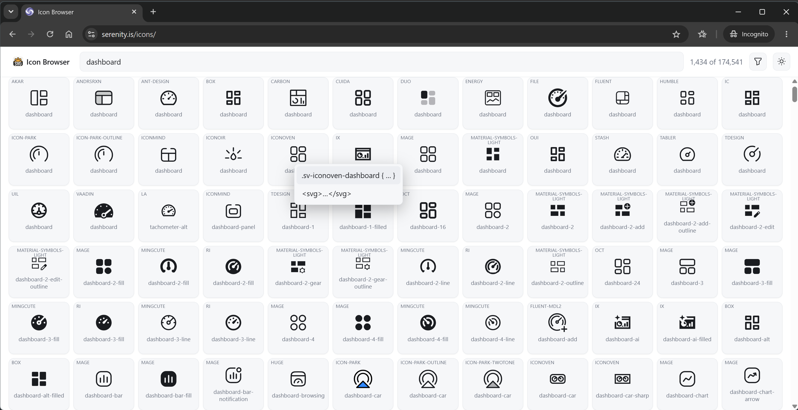
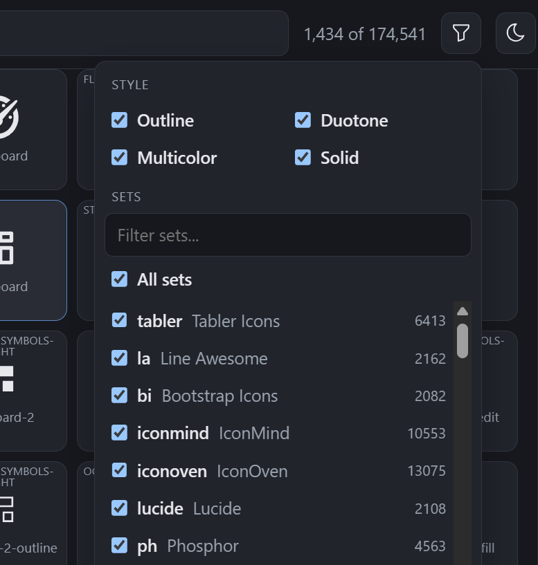
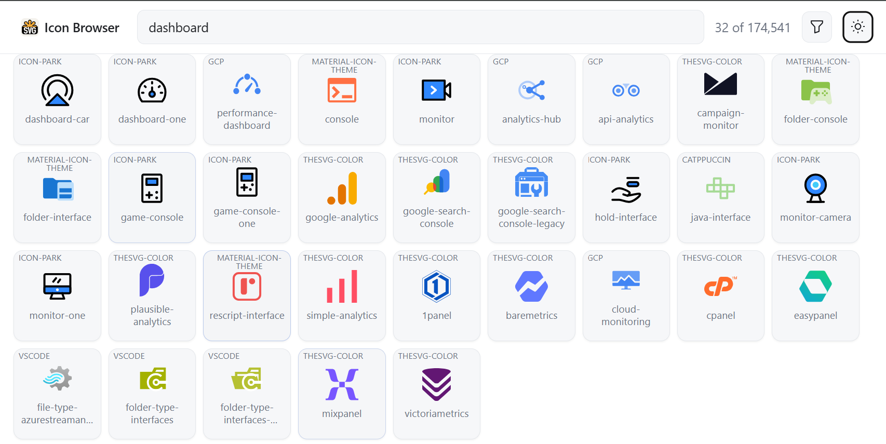

# Serenity 10.6.2 Release Notes (2026-10-25)

These release notes detail the changes made in Serenity and StartSharp from version 10.6.0 to 10.6.2. For a complete list of changes, please refer to the [Serenity Change Log](https://github.com/serenity-is/Serenity/blob/master/CHANGELOG.md).

The bulk of this document covers **10.6.1**, a feature release with two big themes: **icons** (the framework drops the Font Awesome font in favor of SVG mask icons, and a new icon browser makes them easy to find) and **localization** (captions can be localized through explicit text keys instead of name inference). It also adds layout CSS / script bundles, generator and TypeScript tooling improvements, and a non-interactive mode for `sergen`.

**10.6.2** is a packaging release: it only fixes a version mismatch in the common feature packages, so no application code changes are required for it.

## A New Icon Browser

The new icon browser at [https://serenity.is/icons](https://serenity.is/icons) lets you search roughly **175,000 icons** from the Iconify packages and copy the markup for the new icon helper classes. The source is available at [volkanceylan/icon-browser](https://github.com/volkanceylan/icon-browser).

Type a search term and the grid shows matching icons from every bundled collection. Hovering an icon reveals the CSS rule that defines it (a `.sv-<set>-<name>` class whose `--sv` holds the SVG data URL) and the raw `<svg>` markup, so you can use either the helper class or the icon directly:



The filter panel narrows the results by style (Outline, Duotone, Multicolor, Solid) and by icon set (with per-set counts), so you can restrict the search to the families that suit your project:



Multicolor and duotone sets render with their own colors, which is the reason the helper classes come in more than one flavor (see below). The browser also has a light / dark toggle that matches the docs site:



### Icon Helper Classes

The stylesheets now define four reserved class prefixes. Each one consumes a `--sv` custom property pointing at an SVG (usually a `data:` URL), so an icon is just a class plus that property, and no font file is involved:

| Class prefix | Mode | Behavior |
| --- | --- | --- |
| `sv-<name>` | Mask | Monotone icon that follows `color` / `currentColor` |
| `svbg-<name>` | Background | Keeps the SVG's own colors (palette / two-color icons) |
| `svcontent-<name>` | Content | Keeps the SVG's own colors, rendered at its intrinsic width / height |
| `svaccent-<name>` | Accent | Two stacked layers: the main layer follows text color, the accent layer keeps its own color |

```css
.sv-dashboard { --sv: url("data:image/svg+xml,..."); }
.svbg-logo { --sv: url("/icons/logo.svg"); }

.svaccent-bell {
    --sv: url("...bell shape...");
    --svaccent: url("...dot shape...");
    --svaccent-color: #e5484d;
}
```

```html
<i class="sv-dashboard"></i>
<i class="svbg-logo"></i>
```

The unprefixed `sv`, `svbg`, `svcontent` and `svaccent` classes are also defined, so you can combine a mode with your own class that only sets `--sv` (e.g. `<i class="svbg my-icon"></i>`). Things to keep in mind:

- Only the mask mode follows `color` / `currentColor`; the other modes use the colors inside the SVG.
- The content mode renders at the size declared in the SVG's `width` / `height` attributes, so it cannot be resized through CSS.
- Use only one mode per element; the four prefixes are reserved.
- Theme-specific variants are up to you, e.g. `:root.dark .sv-dashboard { --sv: url("..."); }`.
- The accent mode is themed through `--sv`, `--svaccent` and `--svaccent-color`.

### Font Awesome Replacement (**Breaking Change**)

The Font Awesome icon font glyphs in the framework and StartSharp stylesheets are replaced by these mask icons. Each component now sets a `--s-ico` variable with a per-component fallback chain, for example:

```css
.some-component::before {
    --s-ico: var(--s-icon-drag-helper, var(--s-icon-check-circle));
}
```

This makes it possible to override a single icon through CSS, without touching the component's markup:

```css
:root {
    --s-icon-check-circle: var(--sv-some-check-svg);
}
```

**Breaking change:** stylesheets or scripts that override icons through the old font glyphs (`content: "\f..."` together with `font-family` / `font-weight`) no longer work. Set `--s-ico` (for a specific component) or the matching `--s-icon-*` variable instead.

## Localized Captions with Explicit Text Keys

Serenity has always inferred local text keys from string values in attributes like `DisplayName`, `Tab` and `Hint`. That inference is convenient but implicit: a literal caption that happens to look like a dotted key is treated as a key, and the generated registration depends on the attribute and the string shape.

Two new mechanisms make this explicit:

- `DisplayText`, `CategoryName` and `DescriptionText` attributes, which accept an explicit `TextKey` and otherwise register the value as literal invariant text.
- `TextKey` support on the `Hint`, `Placeholder`, `Tab` and `InstanceName` attributes.

```csharp
[DisplayText("Movie Name"), Placeholder("Enter the movie name", TextKey = "Movie.MovieName.Placeholder")]
public string? Title { get; set; }
```

Related pieces:

- Local text registration honors `TextKey` first; otherwise it registers the value as literal invariant text.
- The code generator emits `DisplayText` (for example `DisplayText(TextKey = "Db.Shared.RecordId")` for the ID column) instead of `DisplayName`.
- `IImplicitLocalTextRegistrar` / `AddImplicitTexts` let attributes register implicit text keys and defaults themselves, and the resolution logic is shared through `LocalText.ResolveFromAttribute`.
- Legacy `DisplayName` / `Description` / `Category` attributes keep the old inference, so existing code is unaffected.

**Breaking change:** `Tab`, `Hint`, `Placeholder` and `InstanceName` no longer treat key-looking strings as local text keys. Set `TextKey` when you want a key, and use the plain value for literal text.

## Field Public Names

Row fields can have a `PropertyName` that differs from their `Name` (e.g. a field mapped to a different column), and several call sites had their own `PropertyName ?? Name` logic. `Field.PublicName` now provides this value, and two unified lookup helpers handle the reverse direction:

- `FindFieldByPublicName`
- `FindFieldByPropertyOrFieldName`

Both are also available as `IRow` extension methods. Row serialization, SQL generation, request handlers, lookup / upload, projections, validation and dynamic script call sites were routed through them, so a field can no longer be found by one part of the framework and missed by another.

## Layout CSS and Script Bundles

Dynamically loaded libraries can now ship their own CSS and script files without the application having to reference them explicitly:

```csharp
[assembly: LayoutCssFile("~/MyFeature/lib.css")]
[assembly: LayoutScriptFile("~/MyFeature/lib.js")]
```

- `LayoutCssFileAttribute` / `LayoutScriptFileAttribute` are discovered through the new `ILayoutCssFileProvider` / `ILayoutScriptFileProvider` (with feature filtering, ordering and deduplication).
- `Html.LayoutCssFiles()` / `Html.LayoutScriptFiles()` render them: content-hashed individual links when bundling is off, or a single dynamic bundle per feature set when it is on.
- They are exposed as the predefined `dynamic://CssBundle.LayoutCssFiles` and `dynamic://Bundle.LayoutScriptFiles` bundles.
- The concatenation and minification logic is shared through the extracted `ICssBundleBuilder` / `IScriptBundleBuilder` interfaces.
- A new `IWebRootFileWatcher` provides shared file watching, used by the content hash cache and the layout bundles.
- `CssBundlingOptions.ProcessImports` / `DedupImports` inline relative `@import` statements in bundles, with cycle detection, url rewriting and per-file minification (StartSharp).

### Why the Layout Head Matters

The declared files are meant to be rendered from the layout head, on every page, not from a page entry point. StartSharp's `Views/Shared/_LayoutHead.cshtml` does exactly that, right after the base style and script bundles:

```cshtml
@* Views/Shared/_LayoutHead.cshtml (StartSharp) *@
@Html.StyleBundle("Base" + rtl)
@Html.LayoutCssFiles()

@* ...meta tags, culture, local text... *@

@Html.ScriptBundle("Base")
@Html.LayoutScriptFiles()
```

This is what makes the icons usable in the **navigation** (sidebar, menu items, tabs): the layout shell and its navigation are rendered on every page, *before* the page's own ESM entry point is loaded. A page stylesheet is only applied when that page's module runs, so an icon declared there is not available to the navigation, and the menu shows an empty box until the page opens. Declaring the stylesheet through `[assembly: LayoutCssFile(...)]` puts it in the layout head instead:

```csharp
[assembly: LayoutCssFile("~/MyFeature/navigation.css")]
```

The same applies to scripts that must be present before any page module runs. `Html.LayoutCssFiles()` / `Html.LayoutScriptFiles()` emit content-hashed links when bundling is off, or a single dynamic bundle per feature set when it is on, so the layout head stays short.

The attributes also support `Order`, `RequireFeatures` and `RequireAnyFeature`, so a feature's styles are only included when the feature is enabled (the predefined `dynamic://CssBundle.LayoutCssFiles` bundle is generated once and cached, so it does not follow feature toggles; use `Html.LayoutCssFiles()` where that matters).

## Editor Improvements

### Combobox and Lookup Editors

The combobox and lookup editors became more predictable around asynchronous selection loading and gained icon support:

- `Combobox.ensureSelectionLoaded()` and `selectionLoadState` (also on `ComboboxEditor`) resolve instead of racing the pending initial selection load. Waiters are rejected with an `AbortError` when the load is aborted or superseded, and the last failure is replayed.
- `getSelectedItemAsync()` / `getSelectedItemsAsync()` return the selected item(s) once the load completes.
- The `change` event raised by `setValue` is marked with a dataset flag, so listeners can tell it apart from a user edit.
- An optional `iconField` renders icons in Select2 results and selections; it can also be inferred from `IconClass` / `Icon`.
- `AbstractSelect2`, `SingleSelect2` and `MultiSelect2` are exported, and the Select2 typings are tightened.
- The search input is no longer autofocused on touch devices, and hardware keyboard input (Escape, Enter, arrows, printable characters) is routed to the open dropdown.

### `ServiceLookupEditor`

- A single id produces an equality criteria instead of an `IN` list.
- An empty `idList` returns early without a service round trip.

## `getWindowLocation()`

A new `getWindowLocation()` helper in corelib replaces direct `window.location` assignments in the built-in pages (login, sign-up, password actions, idle timeout, two-factor, external logins). Application code can adopt it so tests can replace the returned location object, since jsdom does not implement navigation.

Use `getWindowLocation({ top: true })` where the redirect must break out of an iframe, as the service call 403 redirect does.

## Grid Titles and Sidebar Icons (StartSharp)

- `DataGrid.getInitialTitle()` / `setTitle()` no longer require a string; they accept `RenderableContent` for grid titles.
- The active sidebar item's icon is shown next to the entity grid title, scoped to the main `#GridDiv` inside `section.content`.

## Sergen in CI: Non-Interactive Mode

`sergen g` / `--generate` can now run without any prompts. `--no-interactive` (aliases `--ni` / `--noninteractive`) skips every prompt:

- Values with a default fall back to it.
- Values without one become required: `--table`, and `--connection-key` when the project has several connections. Missing switches fail with a message naming the switch instead of blocking.

Existing files whose content would change are handled by the new `--overwrite[:mode]` switch:

| Mode | Behavior |
| --- | --- |
| `yes` (default for a bare switch) | Replace, keeping a `*.bak` copy |
| `no` | Fail with exit code 13 |
| `skip` | Leave the file alone and continue |
| `force` | Replace, without a backup |

Aliases: `y` / `yes` / `true` / `backup` for `yes`, `n` / `no` / `false` for `no`, `s` / `skip` for `skip`, `f` / `force` / `overwrite` for `force`.

Without the switch it stays interactive; in non-interactive mode it defaults to failing rather than silently discarding hand edits. A refused overwrite reports the new `OverwriteRefused` exit code (**13**) so scripts can detect it. `--help` can now be combined with a command, and `generate` has its own help text documenting the new switches.

## Running Migrations Without Starting the Web Host

A new `migrate` command runs database migrations and exits, without starting the web server:

```bash
dotnet run -- migrate
```

- `HostMigrationExtensions.RunMigrationsIf` (and a generic overload) returns `null` when the arguments are not a migrate command, and `0` / `1` / `2` for success / failure / extra arguments. Process termination stays with the caller.
- `BaseDynamicDataGenerator.RunIf` has the same contract; `RunAndExitIf` is kept as an obsolete wrapper.
- `IDataMigrations` is now shared under `Serenity.Extensions`, so Serene and StartSharp use a single definition.
- Both templates' `Program.Main` return the resulting exit code, so `dynamic-data` and `migrate` invocations report failures properly, and `using var host` still disposes.

```csharp
public static int Main(string[] args)
{
    if (new AppServices.DynamicDataGenerator().RunIf(args) is int dynamicDataExit)
        return dynamicDataExit;

    using var host = CreateHostBuilder(args).Build();

    if (host.RunMigrationsIf(args) is int migrateExit)
        return migrateExit;

    host.Run();
    return 0;
}
```

**Breaking change:** existing projects that copied `IDataMigrations.cs` into their own project must delete that copy and use the shared one, or dependency injection fails at runtime.

## TypeScript Tooling

- The TypeScript parser port was updated to **TypeScript 6.0.3**, adding `defer` / import phase modifiers, ES2023–ES2025 targets, and import attribute / modifier fixes.
- It also became cheaper: `SyntaxKind` is stored as `short`, node flags are packed into 12 bits, identifier text is materialized lazily, scanner keywords are looked up without allocating substrings, and AST parent pointers plus the unused incremental parsing code are gone.
- `dts-bundle-generator` is replaced by the new in-repo `@serenity-is/dtsbundler`, which uses the workspace TypeScript 7 and native defaults. Bundled `.d.ts` files now use named imports for `ClassTypeInfo` / `EditorTypeInfo` / `FormatterTypeInfo` / `JSXElement` / `Column` instead of inline `import("...")` types (also in StartSharp).

## Repository Tooling

- A new `pnpm cleanup` script removes only well-known regenerable folders (`node_modules`, `.vs`, `obj`, `*.Web/bin`, `artifacts`). It never follows symlinks or junctions, skips `.git`, supports `--dry-run` / `--root`, removes deepest targets first and falls back to a chmod pass for read-only files. It replaces StartSharp's `git-clean.cmd`, which also deleted untracked per-checkout files (Serenity, StartSharp).
- StartSharp now inherits the shared pnpm catalog, `allowBuilds` and `overrides` from `Serenity/pnpm-workspace.yaml` through a `.pnpmfile.mjs` hook, keeping only StartSharp-specific entries local. The hook fails when a `serenity` catalog entry is defined in both places.
- Pro.Coder skips the expensive diagnostics scan in server typings by inspecting global usings directly when the project uses Serenity's global usings, and tracks unresolved Serenity attribute symbols so incomplete design-time compilations still block deletion of generated output (StartSharp).
- `xunit.v3` was bumped to 4.0.2, with `global.json` selecting Microsoft.Testing.Platform and the CI test steps migrated to the MTP argument syntax. Preact was bumped to 11.0.2; class component refs are no longer forwarded, so `MailboxLoginView` captures its root node with a ref callback (StartSharp).
- Repositories renamed `NuGet.config` to `nuget.config` for case-sensitive file systems, and Linux builds include `SkiaSharp.NativeAssets.Linux.NoDependencies`.

## Obsolete Plugin Types

The legacy plugin system types (CSS / script files, navigation, service / background job and `PrecompiledViews` attributes) are marked obsolete in their documentation and point to the supported replacements: `LayoutCssFile` / `LayoutScriptFile`, `NavigationLink` / `NavigationMenu`, and dependency injection.

## Bugfixes

- Generated TypeScript files now emit double-quoted module specifiers, matching the style used by server typings.
- Fixed the `Enums.ImageCheckResult.HeightTooLow` texts, which talked about width, and added the missing `Validation.Int64` message to the web locales. Punctuation in the default English service strings was cleaned up.
- `UpdatableExtension` reported `OtherKey` instead of the `FilterField` value in its error message; it now reports the filter field.
- Require explicit permissions for dynamic scripts, pages and endpoints. A missing permission previously skipped the check entirely, so dynamic scripts without one were public; they now default to denied, pages and services to logged in, and an empty permission is treated as deny. Built-in bundles and scripts are marked `SpecialPermissionKeys.Public`. **Breaking change:** use `SpecialPermissionKeys.Public` (`*`), `SpecialPermissionKeys.LoggedIn` (`?`) or `SpecialPermissionKeys.Deny` instead of magic strings, and set a permission on dynamic scripts or pages that should stay accessible.

## Package Updates

Notable package updates in 10.6.1:

- NuGet: `Markdig` 1.4.2, `Oracle.ManagedDataAccess.Core` 23.26.400, `PuppeteerSharp` 25.14.0, `Microsoft.Extensions.*` 10.0.13, `Microsoft.Build.*` 18.11.0, plus central transitive pinning.
- npm: `tiptap` 3.32.0, `vitest` 5.0.5, `vite` 8.3.5, `jsdom` 30.1.3, `dompurify` 3.4.17, `es-module-lexer` 3.0.4, `chart.js` 4.6.1, `fullcalendar` 7.1.3, `datatables.net-bs5` 3.1.4.

## Upgrading to 10.6.2

1. **Update NuGet packages** to 10.6.2 (StartSharp samples reference `Serenity.*` 10.6.2).

2. **Icon overrides.** Replace any CSS that relies on Font Awesome glyphs (`content: "\f..."` plus `font-family` / `font-weight`) with `--s-ico` or the matching `--s-icon-*` variable. The new icon classes are available immediately; the icon browser is the easiest way to find and copy them.

3. **Text keys.** If you rely on key-looking strings passed to `Tab`, `Hint`, `Placeholder` or `InstanceName`, set `TextKey` explicitly. You can also migrate `DisplayName` / `Description` / `Category` attributes to `DisplayText` / `DescriptionText` / `CategoryName` optionally with an explicit `TextKey` to drop the inference.

4. **Delete the local `IDataMigrations.cs`** from your project and use the shared definition in `Serenity.Extensions`; otherwise DI fails at runtime. Make sure `Program.Main` returns the exit code from `RunIf` / `RunMigrationsIf` so `migrate` and `dynamic-data` report failures.

5. **Dynamic scripts and pages.** Give every dynamic script and page an explicit permission. Scripts default to denied; pages and services default to logged in. Use `SpecialPermissionKeys.Public` / `LoggedIn` / `Deny` rather than magic strings.

6. **CI scripts.** If you generate code in CI, switch to `--no-interactive` together with `--table` (and `--connection-key` when needed) and an explicit `--overwrite` mode. Handle exit code 13 (`OverwriteRefused`) if you choose `no`.

7. **Regenerate generated code** (server typings, client types and row fields) so the new `DisplayText` emission and field public name handling are applied.

8. **Optional adoptions.** Register `LayoutCssFile` / `LayoutScriptFile` for dynamically loaded libraries instead of adding their files to the layout by hand, and render them with `@Html.LayoutCssFiles()` / `@Html.LayoutScriptFiles()` **in the layout head** (as StartSharp's `_LayoutHead.cshtml` does), so their styles are available to the navigation on every page. Also use `getWindowLocation()` in application code so tests can replace the location object.

9. **Tooling (StartSharp).** Update the test projects for xunit.v3 4.0.2 / Microsoft.Testing.Platform, and check Preact 11 class component usages that relied on forwarded refs.
