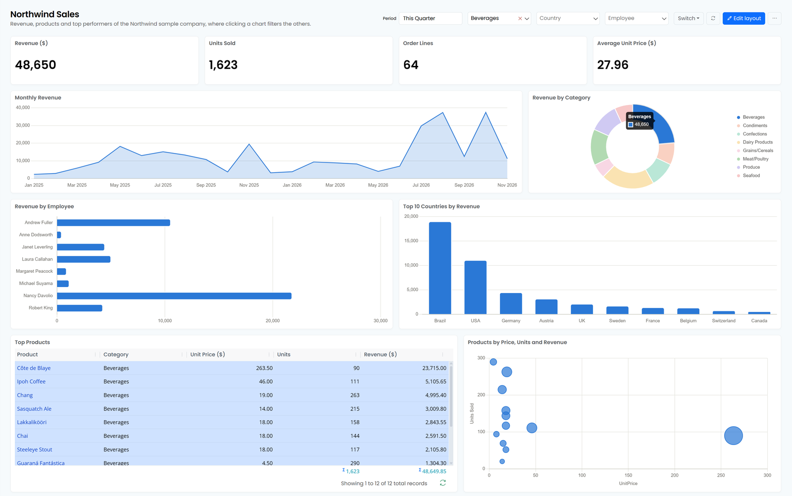
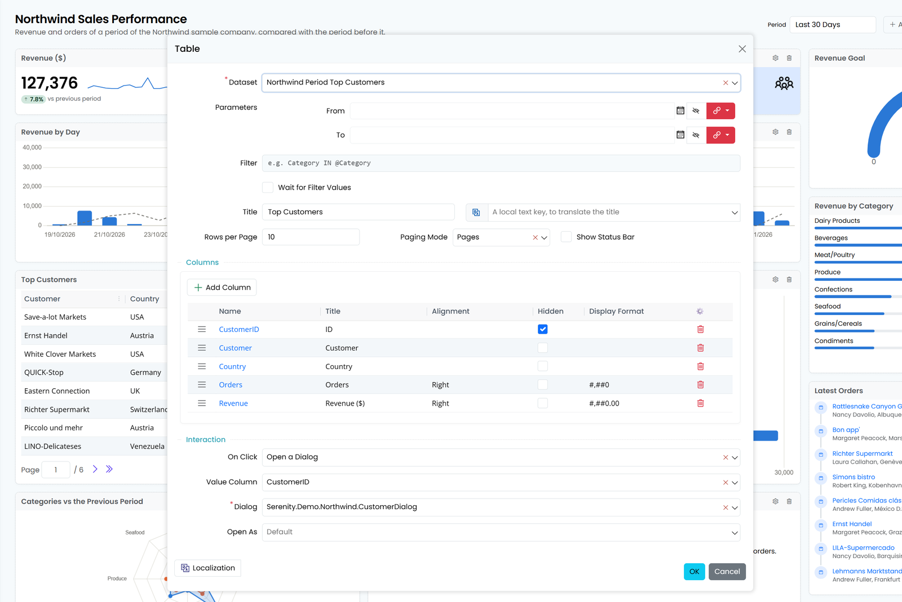
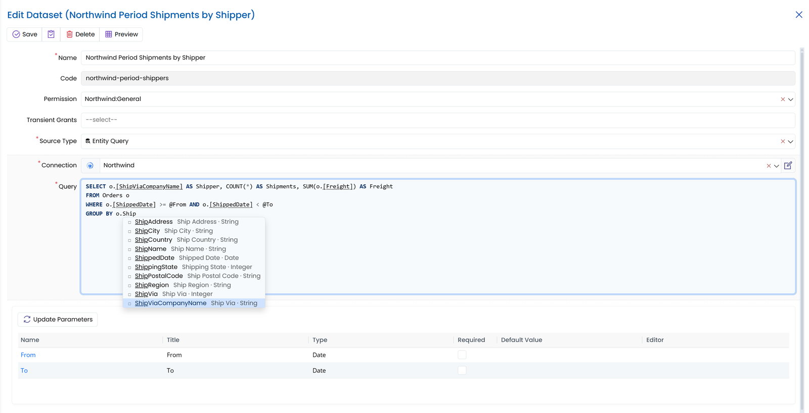
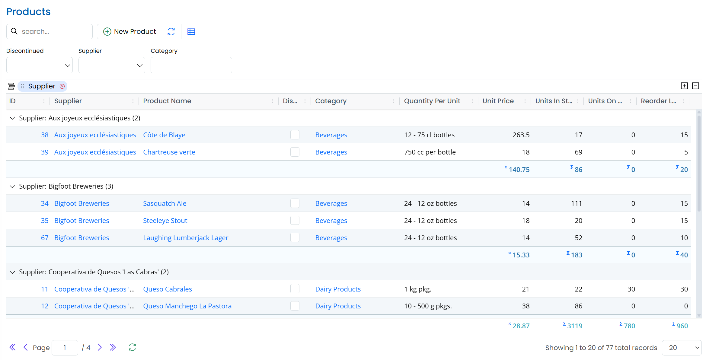
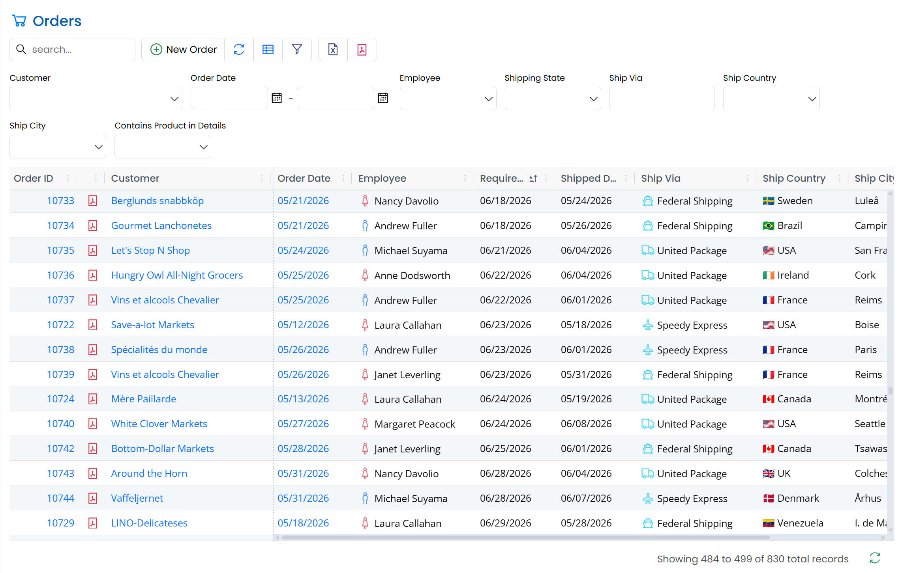

# Serenity 10.7.0 Release Notes (2026-11-17)

These release notes detail the changes made in Serenity and StartSharp from version 10.6.2 to 10.7.0. For a complete list of changes, please refer to the [Serenity Change Log](https://github.com/serenity-is/Serenity/blob/master/CHANGELOG.md).

This is the largest release since 10.6.0 and it has four big themes:

- **Dashboards (Enterprise)**: `Serenity.Pro.Dashboards` ships. Users design dashboards in the browser, over data sources that are configured, permissioned and rewritten for the target database.
- **Server-calculated data**: list requests can now ask for aggregates, group-by and "entities excluded", so grids show correct totals, group totals and counts without loading every row. Date fields can be grouped by intervals (year, quarter, month, week, day, hour) in the user's time zone.
- **One validation model**: the rules a property declares are enforced both in the browser and in save handlers, with the same attributes, the same messages and the same client-side rule classes.
- **A build and asset pipeline you don't have to think about**: project and package `wwwroot` files are served without the .NET static web assets SDK, types can be lazily loaded in groups, and code generation, TypeScript compilation and packaging became incremental.

Along the way there are new editors (`ColorEditor`, `DateRangeEditor`), conditional form fields (`VisibleWhen` / `ReadOnlyWhen` / `RequiredWhen`), infinite and virtual scrolling views, `StringEnum`, inferred form/column/enum keys, attribute inheritance from interfaces, the released `Serenity.Testing` and `Serenity.Testing.Playwright` packages, and a lot of localization and SQL fixes.

**10.6.3** was a patch release between 10.6.2 and 10.7.0. It only pins the TypeScript 7 compiler for new projects, fixes a false warning in `sergen doctor`, bumps packages and reorganizes the packaging scripts, so nothing there requires application code changes. It is covered in [its own section](#1063-patch-release) below.

## Serenity.Pro.Dashboards (Enterprise)

`Serenity.Pro.Dashboards` lets authorized users build interactive dashboards in the browser, on top of the data of the application, without writing code or redeploying. It consists of two modules:

- **Dashboards** (`Serenity.Pro.Dashboards`): the designer and the viewer, with widgets on a grid, filters in the toolbar, click actions, translations and per-dashboard permissions.
- **DataSources** (`Serenity.Pro.DataSources`): the data layer. It defines *connections* and *datasets*, which are named, reusable queries that run with the permissions of the viewer.



Widgets include charts (line, area, bar, pie, doughnut, polar area, radar, scatter, bubble) with configurable series and trends, number cards with server aggregates, tables with virtual or infinite scroll, gauges, funnels, lists, activity feeds, Markdown text and links. Widget properties and table columns can be edited in the designer, including from the grid header.

Aggregation happens in the database: sum, count, distinct count, average, minimum and maximum, with dates grouped by hour, day, week, month, quarter or year and "top groups" limits. Datasets can come from entities, entity queries, tables and views, SQL queries, list services and JSON, and their parameters can be fixed, bound to a dashboard filter, or asked for on the widget itself.



Dashboard filters are kept in the page address (`?f.Category=Beverages`), so a dashboard is linkable and reloadable. A widget's filter expression is a clause such as `OrderDate >= @Period.Start AND Category IN @Category`, and a clause whose filter is empty is dropped. Click actions can set a filter, open a link (for example another dashboard with its filters set) or open an entity dialog. Datasets are resolved per widget, widget errors are isolated in place, and dashboards are versioned with save-conflict handling. Dashboard, menu and widget texts are localizable and stored with the dashboard, so it can be copied to another server with its translations.

Dashboards can appear in the navigation menu, and the home page can display one for everyone, for some roles or users, or as each user's own choice:

```csharp
[PageAuthorize, HttpGet, Route("~/")]
public async Task<ActionResult> Index([FromServices] IDefaultDashboardSelector dashboardSelector,
    CancellationToken cancellationToken = default)
{
    if (await dashboardSelector.SelectAsync(cancellationToken) is { } dashboard)
        return await this.DashboardViewAsync(dashboard, cancellationToken);

    return View(MVC.Views.Common.Dashboard.DashboardIndex, new DashboardPageModel());
}
```

Dashboards can also be used as templates, with a browse page that previews them, and each dashboard can have its own navigation icon.

### Nothing Is Reachable Until It Is Configured

A connection is only usable when it is listed in `DataSources:SqlDataConnector`, and entities, tables and views are each off until their permission is set:

```json
{
  "DataSources": {
    "SqlDataConnector": {
      "MaxRows": 10000,
      "CommandTimeout": 30,
      "ConnectionKeys": {
        "Northwind": {
          "Permission": "Northwind:General",
          "Entities": { "Permission": "Northwind:General" },
          "Tables": {
            "Permission": "Administration:General",
            "Rules": [
              { "Deny": "dbo.Customers(Phone, Fax)" },
              { "Filter": "dbo.Orders", "Where": "EmployeeID = CURRENT_USER_ID", "UnlessPermission": "Northwind:AllOrders" }
            ]
          }
        }
      }
    }
  }
}
```

- **`ConnectionKeys`** are the only connections datasets may use. An entry can also give its own `ConnectionString` and `ProviderName`, e.g. a read-only login to the same database.
- **`Entities`** lets datasets read application entities **through their list handlers**, so the filters and field permissions of the application apply. `DefaultModule` picks the module of an ambiguous name.
- **`Tables`** lets datasets read tables and views directly and write SQL over them. Anyone with this permission can read rows without the entity filters, so grant it carefully.
- **`Rules`** decide which tables, views and columns can be used: `Allow` (optionally with a `Permission`), `Deny` (always wins, except for `UnlessPermission`), `Protect` (unusable through wildcards, only an exact `Allow` makes it usable) and `Filter` + `Where` (row filters that also apply inside joins). A target is `schema.object` or `schema.object(column, ...)`, with `*` wildcards, and `Where` conditions can use `CURRENT_USER` / `CURRENT_USER_ID`.
- **Default rules** allow every table (`*.*`) but protect the sensitive tables of the application (users, roles, mail, audit log, data sources, dashboards, ...) and columns named like Password, PasswordHash, Secret, ApiKey, AccessToken or ConnectionString. Set `UseDefaultProtectRules` / `UseDefaultAllowRules` to `false` to supply your own list.

Datasets run with the **permissions of the viewer**, not of the designer. SQL written in a dataset is never sent to the database as is: it is parsed, checked against the access rules and rewritten for the target database with every value as a parameter, and only `SELECT` queries are possible. A dataset that has to show data its viewers can't read directly (for example grand totals) can be given *transient grants*, which require `DataSources:TransientGranting` plus every granted permission. Filter expressions sent from the browser can't contain subqueries or functions.

### Data Sources in Your Entities

How an entity may be read as a query source is declared with `[EntityQuery]`:

| Mode | Behavior |
| --- | --- |
| `ListHandler` (default) | Through the query of its list handler, with all its filters. A handler that drops rows after its query is refused unless the row explicitly confirms this mode. |
| `Behaviors` | Through a generic list handler with the list behaviors of the entity. |
| `Unfiltered` | From its table and joins, with its permissions but without list handler filters. Never use it for rows that must be filtered, e.g. multi-tenant ones. |
| `Disabled` | The entity can't be used by datasets. |



List services can be used as datasets too, configured by `DataSources:ListService` (`IncludeRoutesRegex`, `ExcludeRoutesRegex`, `MaxCallsPerRequest`). They run in-process through the full ASP.NET Core pipeline, with the authorization of the current user.

### Template Integration (StartSharp)

- The `Dashboards` feature is now **Enterprise only** (it is no longer part of the Business edition) and is enabled by default in the StartSharp VS templates, next to a new `TwoFactorAuthenticator` option.
- `EnterprisePackagesEnabled` is gone: `Serenity.Pro.Dashboards` is always part of the package catalog and is checked for already-published versions, since it actually ships.
- The template's `appsettings.json` gets a `DataSources/SqlDataConnector` block gated by the `Dashboards` option, which registers the Northwind connection key and its `Northwind:General` entity permission when the `Northwind` option is selected.
- The Northwind sales dashboard and its sample datasets are migrations tagged `[SampleData("Dashboards")]`, so they only run when that sample data is requested, e.g. in the public demo. The feature's tables are named `dash_*` (dashboards) and `dsrc_*` (data sources), and they were added to Data Explorer's default exclusions since they are internal.

Because dashboards add navigation items at runtime, the navigation cache has to depend on the item group key so the menu updates without waiting for a cache expiration or a restart:

```csharp
Items = cache.GetLocalStoreOnly("LeftNavigationModel:NavigationItems:" +
    (userAccessor.User?.GetIdentifier() ?? "-1"),
    TimeSpan.Zero,
    [UserPermissionRow.Fields.GenerationKey, NavigationCaching.ItemsGroupKey],
    () => NavigationHelper.GetNavigationItems(permissions, typeSource, serviceProvider,
        url => ToAbsolute(url)!))!
```

**Custom widgets** are a C# options class marked `[DashboardWidgetType("<client class key>")]` plus a client widget registered with that key; widgets in other bundles can be loaded on demand with `LazyLoadInclude`. **Custom variables** (e.g. `CURRENT_TENANT_ID`, which must start with `CURRENT_`) are registered through `IDataVariableProvider`.

## Server-Side Aggregates and Grouping

Until now a grid could only show totals for the rows it had loaded: the footer of the grid, and the totals of a grouping, reflected the current page. On large tables they were therefore misleading, and asking the server for a sum meant writing a custom service.

`ListRequest` now carries the calculation itself:

```csharp
public class ListRequest
{
    public List<AggregateBy>? Aggregates { get; set; }
    public List<GroupBy>? GroupBy { get; set; }
    public bool ExcludeEntities { get; set; }
    public string? TimeZone { get; set; }
    // ...
}
```

- `AggregateBy` is a field plus an `AggregateType` (`Sum`, `Avg`, `Min`, `Max`, `Count`, `DistinctCount`), and `AggregateBy(null, AggregateType.Count)` counts the rows.
- `GroupBy` is a field, an optional `Descending` flag and an optional `Interval`, and groups are nested, the outermost first. `AggregateGroup.More` tells that a level has more groups than returned.
- `ExcludeEntities` asks only for the count and the aggregates: the handler reads a single row and clears the entities.
- `TimeZone` (an IANA name like `Europe/Istanbul`, or a Windows one) tells where the days start for interval grouping, so UTC dates are grouped by the days the user sees. Filters and returned dates are unaffected. An unknown zone throws `ValidationError("InvalidTimeZone")`.

Handlers declare what they support with new `ListRequestCapabilities` values, so a client can detect support before asking:

| Capability set | Contains |
| --- | --- |
| `ListHandler` | The baseline list handler, currently the same as `Baseline` (filtering, sorting, paging, columns, distinct, localization, `IncludeMore`, `ExcludeEntities`) |
| `ProListHandler` | `ListHandler` + `AggregateOptions` (`Aggregates`, `GroupBy`, `ExcludeEntities`, `TimeZone`) |
| `SourceAdapter` | The in-memory source adapter, which supports all of the above |

The base `ListRequestHandler` itself only honors `ExcludeEntities`. Aggregates, grouping and time zones are filled in by `ListAggregatesBehavior` in `Serenity.Pro.Extensions` (or by a list source adapter that supports them), so a Serene project without pro features ignores those request options and grids keep calculating totals from the loaded page.

### How It Is Calculated

`ListAggregatesBehavior` runs after the filtering behaviors, so it counts what the user is allowed to see, and uses a single `ROLLUP` query for all group levels on SQL Server, PostgreSQL, Oracle and MySQL (per-level queries elsewhere). It sets `TotalCount` and `More` from the totals query and clears `CountRecords` on the list query, so rows are not counted twice. Each level is capped at `MaxGroupsPerLevel`; fields are validated against the selectable/readable fields, grouping is dropped when a group field is not allowed, and sums/averages over non-numeric fields are skipped.

Date intervals are translated per dialect with weeks starting on Monday, and time zone conversion is generated for SQL Server, PostgreSQL, Oracle, MySQL, Firebird and SQLite (named zone conversion where the dialect has it, a fixed current-offset fallback otherwise, with the DST limitation documented). When the target source does not support them, aggregates and intervals are mirrored by `ListRequestLocalAggregates` in the in-memory source adapter: totals are computed from all matching items **before** paging, and entities are dropped afterwards when `ExcludeEntities` is requested.

`IListResponse` members are now settable, so a behavior that has already counted the rows can supply `TotalCount` / `More` directly and avoid a second count. `ListResponse<T>.Entities` has an explicit setter that converts any assigned `IList` into a `List<T>`. `SummaryType` and `AggregateType` members now have localized texts, and `AggregateType` numbers are aligned with the matching `SummaryType` values so the two enums map to each other.

### In the Browser

`RemoteView` gained a `serverAggregates` option: it asks the server for grand totals and per-group totals/counts, and falls back to the page rows when the server returns none, when the aggregator is unsupported, or when a local filter hides rows. It reloads only when aggregates, groupings or sort change, orders request results by the grouping fields in the view's sort order (so rows of a group stay together, and the groups the server had to leave out are the last ones), and keeps the previous totals when a request reuses them (`totalsKept`).

StartSharp turns this on for all grids with a single script init:

```ts
// src/StartSharp.Web/Modules/Common/script-init/aggregates-init.ts
DataGrid.defaultOptions.serverAggregates = true;
```

The requested aggregates are derived from the grid's own configuration (the grand aggregators and the group aggregators), so a column with a summary type and a grouped grid work without additional code. A grid can still override it in `getViewOptions()`.



## Infinite and Virtual Scrolling (StartSharp)

Two new views change how large grids paginate, both in `Serenity.Pro.Extensions`:

### `InfiniteScrollView` / `InfiniteScrollPager`

Loads rows in chunks and appends the next chunk when the bound grid nears its last loaded row, so the grid scrolls continuously without page navigation. The pager shows a reload button and a loaded/total status (including indeterminate counts), preserves loaded rows and scroll position on refresh for the same query, deduplicates rows returned again, and keeps the server totals and aggregates from the initial request.

### `VirtualScrollView` / `VirtualScrollPager`

Exposes a row for **every** row the request matches, while only loading the ones near the viewport. The scrollbar covers all rows, any row can be scrolled to without loading everything before it, and rows far from the viewport are released past `maxLoadedRows` (5000 by default) to be loaded again when scrolled to. Because not all rows are present, sorting, grouping and aggregation are done by the server; groups are listed even when none of their rows are loaded. `loadDelay` (50 ms by default) debounces requests while scrolling.



### Under the Hood

- `RemoteView.page`, `totalCount` and `more` are now `protected` so a subclass can read and adjust the paging state. Extract `applyResponse`, `setRequestPaging` and `keepServerTotals` hooks let a view that loads rows in another way (e.g. by appending) reuse the paging logic instead of duplicating it.
- `RemoteView.addData` no longer aborts a request that `onProcessData` starts itself (e.g. a grid that learns its columns from the data and then asks for summaries). `onProcessData` now runs after the loading state of the finished request is cleared, and cleanup only clears loading when it still belongs to the finished request.
- `InfiniteScrollPager` accepts any view that can bind to a grid through the new `ScrollLoadingView` interface, and its status range moved into an overridable `getRange`.
- The grouping helpers of `RemoteView` (normalization, server group lookup, request sort/grouping/aggregate construction, group value formatting, `groupingDelimiter`, `groupKeyText`) are now public statics, so the same logic can be used without a view instance.

### Indeterminate (Load-More) Paging

Counting every row is slow on large tables, so a grid can now ask whether more rows follow instead:

- `RemoteView.indeterminatePaging` sends `IncludeMore` instead of `ExcludeTotalCount`. The total count then reflects only the rows known so far, and an empty page past the end falls back to the last page that has rows.
- `PagingInfo.indeterminate` / `PagingInfo.hasMore` tell consumers that the paging is open-ended.
- `SlickPager.indeterminatePaging` hides the last-page button and the total pages, disables the next button when there are no more rows, and accepts any page number typed in.
- The new `PagerTexts.RangeStatus` ("Showing {from} to {to} records") covers the unknown-total case and is translated for all locales.


## Unified Server and Client Validation

A property now declares its constraints once, and both the browser and the save handler enforce them.

### The `Validate*` Attributes

New attributes mirror the DataAnnotations ones but also describe themselves to the client:

| Attribute | Client rule | Implied message key |
| --- | --- | --- |
| `ValidateRange` | `Serenity.RangeValidationRule` | `Field_ValidateRange` |
| `ValidateLength` | `Serenity.LengthValidationRule` | `Field_ValidateLength` |
| `ValidatePattern` | `Serenity.PatternValidationRule` | `Field_ValidatePattern` |
| `ValidateEmail` | `Serenity.EmailValidationRule` | `Field_ValidateEmail` |
| `ValidateUrl` | `Serenity.UrlValidationRule` | `Field_ValidateUrl` |
| `ValidateCompare` | `Serenity.CompareValidationRule` | `Field_ValidateCompare` |

They implement `IClientValidationRule`, so the rules travel to the form as `PropertyItem.validationRules`, and `PropertyGrid` attaches them to the editors through `Validator.addCustomRule`, skipping read-only and hidden fields exactly like the browser does. Messages are localizable by the implied key, or by an explicit `TextKey`, and the limits of a range are parsed and converted in the invariant culture. An empty value is always valid, as being required is `RequiredAttribute`'s concern.

### Custom Rules

`ValidationRuleAttribute` is the base of a custom rule that the forms also check. The client class is found by its type key (a `Key` constant of the attribute, or the convention `ValidateEvenAttribute` → `MyApp.EvenValidationRule`), the server typings generator imports it into the forms that use it, and a rule that implements `LazyLoadInclude` can be loaded on demand instead:

```csharp
public class ValidateEvenAttribute() : ValidationRuleAttribute(Key)
{
    public const string Key = "MyApp.EvenValidationRule";
    protected override string DefaultTextKey => "Validation.Even";
    protected override bool IsValidValue(object? value, ValidationContext context) =>
        Convert.ToInt64(value, CultureInfo.InvariantCulture) % 2 == 0;
}
```

```ts
export class EvenValidationRule extends ValidationRule implements LazyLoadInclude {
    static override [Symbol.typeInfo] = this.registerRule("MyApp.");
    override textKey = "Validation.Even";
    override defaultText = "Please enter an even number.";
    check(value: any) { return Number(value) % 2 === 0; }
}
```

`ValidationRuleTypeRegistry` finds rules by their type key, so a rule can also be registered by a plain function. Rules that need to wait (for example for a query) override `IsValidValueAsync` (`IAsyncValidationRule`), which asynchronous save handlers await while synchronous callers still use the synchronous value.

### Validating What the Form Checks

`FormValidationAttribute` makes the save handlers validate by a form, i.e. the checks the row itself doesn't have: the form's `RequiredAttribute`s, `RequiredWhenAttribute`s and validation rules, skipping the fields the form hides or makes read only. It can be on a save handler or on a row for the handlers that have none, and a handler can choose a form by overriding `GetValidationForm` when an entity has more than one form.

`ValidationRules.ValidateObject` runs that validation directly, and save handlers now have a service provider so a rule can reach the connection and the localizer.

**Breaking change:** `ICustomValidator`, `IValidationContext` / `ValidationContext` and `RowValidationContext` are replaced by the DataAnnotations-based `ObjectValidator`. Custom validators should become a `ValidationRuleAttribute` (plus a client-side rule class for the forms) or a plain `ValidationAttribute`.

### Locale Coverage

The missing `Validation.Compare`, `Validation.Invalid`, `Validation.Pattern` and `Validation.RangeLength` texts were added to every locale plus the English fallback, so a rule message resolves to localized text instead of a raw key.

## Conditional Form Fields

A field can now depend on the value of another field:

```csharp
[VisibleWhen(nameof(Action), MyAction.OpenLink)]
[ReadOnlyWhen(nameof(IsSystem))]
[RequiredWhen(nameof(Action), MyAction.Save)]
public string? LinkAddress { get; set; }
```

- `VisibleWhen`, `ReadOnlyWhen` and `RequiredWhen` are `PropertyConditionAttribute`s; a property can have several of the same kind and they must all be met. No values means "has a value" ("checked", for a checkbox), and `IsNot` inverts the condition. A named rule is a one-liner: `public class ForLinkAttribute() : VisibleWhenAttribute(nameof(Action), MyAction.OpenLink) { }`.
- The conditions are projected into `PropertyItem` metadata (`visibleWhen`, `readOnlyWhen`, `requiredWhen`, `clearWhenHidden`) and evaluated by `PropertyGrid` when values load and change. Categories and tabs whose fields are all hidden are hidden too.
- `clearWhenHidden` saves a value hidden by a condition as empty, so stale values don't come back when the field is shown again.
- The shared helpers are used by both the server and the client, and the generated typings expose the new condition types.

Conditions are for forms only and are **not a security boundary**: a request can still contain a value for a field that is hidden or read-only, so permissions and the service still decide what is saved.

## Static Assets Without the SDK

Serenity no longer depends on the .NET static web assets SDK for project and package `wwwroot` files. `Serenity.Net.Web` ships its own targets and serves, publishes and packs those files from a build output manifest:

```csharp
var builder = WebApplication.CreateBuilder(args);
builder.WebHost.UseSerenityStaticAssets();
```

- `SerenityStaticAssets.targets` collects the files (`SerenityStaticAssetIncludes` / `Excludes`, with SDK-like default excludes and a whitelist option), writes `[AssemblyName].serenitystaticassets.json`, and `PrefixedFileProvider` serves them under `StaticWebAssetBasePath` or the assembly name. Publishing copies them to `wwwroot\[BasePath]\`, and packing puts them under `staticwebassets\` with a `buildTransitive` props file for consumers.
- The manifest also carries the publish include/exclude patterns, so files that would not be published or packed are no longer served (`StaticAssetPatternFilter`, `FilteredFileProvider`), and the long default pattern lists are shared as pattern sets instead of being repeated per folder.
- Eligible files are precompressed to `.br` / `.gz` on publish (`CompressStaticAssetsTask`, cached in the intermediate output, Brotli only when MSBuild supports it, with a visible notice otherwise), and the host serves the matching variant with `Vary: Accept-Encoding`.
- The build tasks now ship compiled in the `Serenity.Net.Web` package instead of being recompiled with `RoslynCodeTaskFactory`, and `SERSA001` / `SERSA002` warnings point out a referenced package or project that still needs the SDK (silence with `SerenityStaticWebAssetsCheck`).
- The static asset manifest is now propagated reliably to referencing projects (e.g. a functional test project that needs the manifest next to its assembly) by resolving the roots in a `_ResolveSerenityStaticAssetsForContent` target that runs before `AssignTargetPaths` in `GetCopyToOutputDirectoryItems`.
- The TypeScript and `sergen` transforms became incremental, with input lists and stamp files, so a rebuild only regenerates what changed.

**Breaking change:** projects must call `UseSerenityStaticAssets()` instead of `UseStaticWebAssets()`, or keep static web assets enabled. The Serene and StartSharp templates set `StaticWebAssetsEnabled=false` and call the new method. Projects that reference a package or project which still uses the SDK must set `StaticWebAssetsEnabled` back to `true` (or follow the `SERSA001`/`SERSA002` warnings). `wwwroot` files are now `None` items instead of `Content`, so custom content rules may need adjusting.

## Lazy Loading Types in Groups

Types that are only referenced by key — for example the editors of dynamically generated property items — can now be registered for lazy loading:

- `LazyLoadInclude` (optionally `LazyLoadInclude<"Group">`) marks a type, and code generation registers it in `LazyTypeLoader.mts` with **literal dynamic imports**, so bundlers can split types into chunks. Types with the same group share a single `LazyTypeGroup.<Group>.ts` chunk instead of one chunk each.
- `LazyLoadTypesAttribute` and `Html.LazyTypes()` render the content-hashed module URLs and their keys as JSON; both templates add it to the layout head. `Config.lazyTypeLoader` is the default loader and can also answer availability checks without importing a module.
- `QuickFilterBar` and `EditorFiltering` accept promise-like widget types with placeholders, preserving saved state, values and handlers until the real widget is ready.
- `PropertyGrid.getEditorsLoading()` returns a promise for the editors that are still loading (or `null` when none are), so a caller can wait before saving, since a lazily loaded editor can't save its value until its widget exists.

The demo Northwind formatters and entity dialogs are now lazily loaded, with the eight dialogs sharing a single `NorthwindDialogs` group:

```ts
export const lazyTypeGroupNorthwindDialogs: Record<string, any> = {
    // ...
};
```

## Inferred Keys for Forms, Columns and Enums

`FormScript`, `ColumnsScript` and `EnumKey` gained `InferKey`, so keys no longer have to be spelled out. With `InferKey = true` the key is derived from the `[Module]` attribute, the `BasedOnRow` type or the namespace, dropping the root namespace and the `Forms` / `Columns` segment and the `Form` / `Columns` / `Request` suffix:

```csharp
[FormScript(InferKey = true)] // Serenity.Pro.Meeting.Forms.MeetingForm -> Pro.Meeting.Meeting
public class MeetingForm { }
```

A parameterless `EnumKeyAttribute` implies `InferKey`. The key resolution is shared, so the server typings generator, `FormScriptRegistration`, `ColumnsScriptRegistration` and `PropertyItemsLocalTextRegistration` all agree — previously a columns script could register itself under the full type name while its generated `columnsKey` used another form, and `.Enums` / `.Lookups` suffixes were stripped inconsistently. Note that `Lookups` keeps its namespace segment now, since only `.Forms` and `.Columns` are stripped by the convention.

The StartSharp pro feature modules (meeting, worklog, email client, data audit log) were migrated to inferred, shorter keys (`Serenity.Pro.Meeting.Forms.MeetingForm` → `Pro.Meeting.Meeting`), so **regenerate server types and texts** after updating and check any place that hardcodes a form/column key.

## Attributes From Interfaces

A property now also receives the attributes declared on the members of the interfaces it implements:

- `GetPropertyAttribute` / `GetPropertyAttributes` and `WrappedProperty` resolve interface members, including intrinsic/combination attributes, and validation, property grids, row mapping, localization, reporting and server typings all use them, so shared interface properties behave like normal property items.
- Precedence is unchanged: own and base attributes win, `AllowMultiple` attributes from interfaces are appended, explicit interface implementations are ignored, and interfaces are ordered deterministically.
- Combination attributes are now read from `CustomAttributes` **metadata** instead of `GetCustomAttributes`, so their constructors never run during reflection. This fixes an infinite recursion when a combination attribute refers to its own row and reads its attributes in its constructor (e.g. a `ForeignKeyAttribute`-based attribute).
- Own attributes now win over intrinsic ones: an attribute set directly on a property is not shadowed by the same type exposed through a combination attribute, except for attributes that allow multiple instances (`Tag`, for example).
- The RowFields source generator applies the same resolution for `[IdProperty]`, `[NameProperty]`, `[Column]` and `[Size]` (StartSharp), so rows that get their id/name/column name/size from an interface generate the same code as the runtime resolves.

Behavioral change: generated field names, sizes and id/name interfaces can now change for rows that used interface-level attributes. Regenerate and review the diff.

## Property Grid and Editor Improvements

- **Base property order.** `BasePropertyOrderAttribute` (`BasePropertyPosition.Default` / `Before` / `After`, `TypesBefore` / `TypesAfter`, `WhenInherited`) lets a type control where inherited properties appear in forms and property grids instead of relying on declaration order. It composes across multi-level hierarchies, and specific base types can be ordered before or after the type's own properties.
- **Editor attribute templates.** A custom editor attribute inherits defaults from an editor attribute declared on its class while explicit options still win. Service lookup templates only supply item type, endpoint type and action name when the attribute defines no endpoint, and lookup template options are copied into filtering (now including capabilities and quick search fields).
- **Generated editor defaults.** The server typings generator emits `<Editor>Defaults` constants for lookup and service lookup attributes with a template, resolving service/action, capabilities (as named enum members like `FilteringOptions | Sort | PagingOptions`), id/text/icon fields and lookup keys the same way the server does. `QuickSearchFields` and a typed `Sort` (string array) were added to `ServiceLookupEditorBaseAttribute`, and `SetServiceLookupParams` is public.
- `BooleanEditorAttribute` / `BooleanEditorOptions` now take the `CheckLabelPosition` enum: `Start` (default), `End` (checkbox first, caption after, several checkboxes per row) and `EndAligned` (like `End`, but the caption area is left empty so a checkbox alone in its row lines up with the editors above). The CSS hides the end-aligned spacer in vertical forms and below 760px.
- **`ColorEditor`** (StartSharp) types a color as hex text (`#d9e6ff`, `#d9e6ff80`) or `rgb()`/`rgba()`, and opens a `ColorPickerPanel` popover from a swatch: a saturation/brightness area, hue and alpha sliders, hex/RGBA fields and an eyedropper. `ColorUtils` parses and formats colors, converts RGB/HSV and computes readable text colors. The popup follows its swatch on scroll and resize, and both the editor and its texts are localizable.

  

- **`DateRangeEditor`** (StartSharp) edits a range as text or from a flatpickr range calendar with predefined ranges that follow the current date, storing the range name when it has one so it stays correct as days pass. `DateRange` gained parsing, formatting and naming with localized names, plus `PreviousStart` / `PreviousEnd` / `PreviousEndExclusive` parts for comparing with the previous period and an `EndExclusive` part so `OrderDate < @EndExclusive` covers the last day of a date-time range.

  

- **Select2 no longer masks the editor.** The select2 container copied the input's classes, including `editor`, and was inserted before the input, so any code looking up a field's editor found the container. It now adapts the class to `editor-like` via `adaptContainerCssClass`: the container still gets the editor's width/layout styling, but no longer claims to be the editor. `editor-like` was added to the readonly, `.field` and `.input-group` theme rules, and an editor wrapped in an input group with addons gets the same class so it lines up with plain editors.
- **Validation icon in input groups.** The error icon got `flex: 0 0 auto` so it keeps its size, it is revealed when the error element is nested in an input group (`.input-group:has(> .error)~.vx`), and a field's input group now flexes and shrinks (`flex: 1 1 0.01%`, `min-width: 0`, `width: auto`) so it shares the row with the icon instead of pushing it out of view.

## Grid and DataGrid Fixes (StartSharp)

- Cancelling a cell edit with **Escape** consumes the keystroke, so it no longer closes a containing dialog, and the keystroke stays within the grid.
- Drag plugins no longer intercept presses inside an open editor, which made text selection impossible.
- The active edit (column, row, item id, add-row flag and typed value) survives an **auto save**: it is captured before the save and restored afterwards, an item's new row is followed when the save reorders rows, `grid.refresh()` is skipped while an editor is open, and the edit value is selected after loading so typing replaces it.
- A column whose `maxWidth` is `null`, `undefined` or `0` is treated as unlimited when autosizing.
- Scrollbar thickness is measured from bounding rects and rounded up, and the cached dimensions are invalidated when `window.devicePixelRatio` changes, so a zoomed page no longer gets a spurious horizontal scrollbar. `SleekGrid` re-checks the dimensions on every resize, not only when they are missing.
- Header menu and header filter dropdowns are reparented into the closest modal or `document.body`, so modal overflow and stacking contexts no longer clip them.
- `ComboboxOptions.formatResult` receives the result, container and `Select2QueryOptions` like the Select2 formatter, `CheckLookupEditor` / `ComboboxEditor` unbind their cascade link on destroy, and a draggable grouping honors the `collapsed` option.
- The local (in-process) service lookup no longer drops custom request properties that are not list request options: request keys are mapped to capabilities explicitly instead of being looked up by name in the capabilities enum, so unrelated option names are no longer matched and unsupported ones are still removed.

## Enums, String Enums and Editors

- **`Serenity.StringEnum`** stores a set as strings instead of numbers: cached `StringEnumInfo` / `StringEnumMember` lookups (name, value, text, visibility) and `IsStringEnum`, `GetName`, `GetValue`, `GetValues`, `GetNames`, `IsDefined` and `GetText` helpers. `StringEnumField<T>` maps it to a string column and rejects JSON values that are not members through a new `ConvertJsonValue` hook on `StringField`.
- `EnumEditorAttribute` now takes a `Type` or an enum key, so a plain string property can use a set. `EnumKey` / `IgnoreUIField` work on string enum members, local texts register under the usual `Enums.<key>.<name>` keys, and generated TypeScript is a const object plus a union type and a `registerEnum` call. `EnumSelectFormatter`, `EnumEditor` and `RadioButtonEditor` handle string values instead of their numeric-only workarounds.
- **Flags.** `registerEnum` takes `enumFlags` (emitted for `[Flags]` enums), `Enum.toString` returns a named member or the fewest members that make the value like .NET, and `EnumEditor` has a `flags` option so a multiple editor stores the OR of the selected members and skips `None` while combined members exist. `ServiceLookupEditorBaseAttribute` edits `Capabilities` with such an editor, and `EnumJsonConverter` accepts any valid flags combination (including `ulong`-backed enums).
- **Icons.** Enum members can declare `IconClass`, emitted as `enumIcons` and exposed through `Enum.getIconClass`. `EnumEditor.mapEnum` / `mapIcon` hooks were extracted for subclasses, and `ColumnSelection` / `RetrieveColumnSelection` are registered under their server-side full names.
- `SummaryType` and `AggregateType` members now use `[DescriptionText]`, with `Enums.*` texts registered in the core and services resources for every locale.

## SQL, Expressions and Migrations

### Expressions

- New `Cast`, `Replace`, `Substring` and `Trim` / `TrimLeft` / `TrimRight` expression attributes, translated for every supported dialect (SQL Server pre-2017 `TRIM`, MySQL cast types, Oracle date truncation, SQLite type affinity, Firebird's missing `LTRIM` / `RTRIM`). `TrimAttribute` options are `init`-only.
- `DateAdd` was added, and `DateDiff` now counts the **part boundaries crossed** like SQL Server's `DATEDIFF` instead of complete units (SQLite `STRFTIME`, PostgreSQL `DATE_TRUNC`, Oracle `TRUNC`, MySQL `DATE_FORMAT`), with end-of-month dates clamped for month/year addition.
- `RegexWithDefault` combines regex patterns, so a default pattern can be extended instead of replaced.
- Fixed `SqlDateTimeOffset` translations (PostgreSQL `CURRENT_TIMESTAMP`, SQL Server `SYSDATETIMEOFFSET()`) and `SqlUtcNow` now uses Firebird 4 time zone support. Oracle parameters are bound by name (`BindByName`) so repeated or reordered expression parameters get the right values, and single parameters are cast for Firebird in `DatePart` and `Concat`.
- Oracle `CONCAT` is no longer wrapped in `COALESCE(..., '')`: Oracle's `CONCAT` only returns null when both arguments are null and an empty string is already null there, so the wrapper was redundant — and it failed with a character set mismatch for `NVARCHAR2` arguments.

### Collations and Databases

- `SqlCollationSpec` / `SqlCollationMapper` translate ordinal, invariant and culture comparers with case/accent options into engine-specific collation names. The connection `Collation` accepts `automap`, `tryautomap` and `tolerant` keywords (plus `IgnoreAccents`) and resolves them from the connection's `Comparer`.
- `EnsureDatabase` takes an optional collation (SQL Server/MySQL/Firebird `COLLATE`, PostgreSQL `TEMPLATE template0` with locale or ICU, rejected for SQLite and Oracle), defaulting to the connection's collation, with `PartialContainment` support and no `COLLATE` / `CONTAINMENT` when attaching existing SQL Server files. `MapCollation` / `TryMapCollation` migration helpers were added, and `MigrationUtils.ClearAllPools` clears only the migrated database's pools instead of every pool in the process.

### Migrations

- **Dimensioned tags.** `MigrationTagUtils` groups tags by the part before the `:` and requires every declared dimension to match, while keeping FluentMigrator's RequireAny/RequireAll rules within a dimension. The `db:` dimension is a partition: a migration runs when any of its databases is requested, and legacy tags like `DefaultDB` normalize to `db:Default` only when that database is requested. An `env:Staging` tag is therefore a real gate now. Assign `MigrationTagUtils.CreateMatcher()` to `IMigrationRunnerConventions.TypeHasMatchingTags` and use `TargetDBAttribute`, which declares both forms.
- **Sample data.** `SampleDataAttribute` gates sample migrations behind `sample:All` or a per-module tag such as `sample:Dashboards`.
- **Non-integer user IDs.** `UserEntityOptions.SystemUserId` (with `GetSystemUserId` / `HasIdentityUserId`) is the user that system-created rows are attributed to; it defaults to `1` for `Int32`/`Int64` IDs and must be set for `Guid`/`String` IDs. The initial migration creates the Users table with a plain primary key when user IDs are not database-generated.
- Migration edge cases were fixed: a raw `ALTER TABLE` on Oracle when setting an already nullable column, the oversized composite `FileSystem` index skipped on Firebird, the Oracle concurrency version trigger executed through `WithConnection` (FluentMigrator's splitter cuts PL/SQL blocks), identifiers quoted through the dialect, Firebird identity generators reset after seeded rows, and provider-specific SQL matched by prefix so versioned dialect names like `Postgres15_0` are not silently skipped.
- Additional SQL types are mapped for schema generation (`boolean`, `bytea`, `double precision`, `json`, `jsonb`, `uuid`) and `DateOnly` values are handled when reading and converting `DateTime` fields, since providers like Npgsql return `DateOnly` for date columns.

## Users, Roles and Login

- **`IUserListService` / `IRoleListService`** with `BaseUserListService` / `BaseRoleListService`, so pickers can list users and roles while selecting only what a list item needs — nothing like a password hash is loaded. Ids and usernames are chunked to stay below parameter limits, normalized usernames are used when available, and users requested by id or username are listed whatever their state. Register with `AddUserListService` / `AddRoleListService`.
- **`IRoleKeyRow`** and `GetKeyOrName`, so renamed roles keep a stable key for the permissions stored against them.
- **Normalized username and email.** `INormalizedUsernameRow` / `INormalizedEmailRow` and `BaseUserRetrieveService.NormalizeUsername` / `NormalizeEmail` compose Unicode and fold case (including Turkish ı/İ), so username and email lookups no longer depend on the database collation. The Serene and StartSharp templates add `NormalizedUsername` (unique, not null) and `NormalizedEmail` (indexed) columns with backfill migrations that use the SQL equivalent of the normalizer, keep them in sync in user save, sign-up and LDAP sync, and use them for duplicate checks and login throttling.

## Security and Request Hardening

- Retrieve, list and list-Excel actions of the Northwind demo modules, the Serene administration endpoints and the StartSharp/pro-features endpoints now have `[HttpPost]` plus `[AuthorizeRetrieve]` / `[AuthorizeList]`, so read operations enforce the same row-level permission checks as the rest of the CRUD surface and can't be triggered by other verbs. The `FileExplorer` endpoint got `ServiceAuthorize`, and the Data Explorer list and translation endpoints got `[HttpPost]`. Do the same in your own endpoints.
- Data Explorer (StartSharp) now applies its default table exclusions to **every** connection (`UseDefaultExcludeTables`, true by default), adds `ExcludeTablesRegex` to the default pattern instead of replacing it, matches sensitive tables with or without a schema prefix and case-insensitively, and also hides `DistributedCache`, `FileSystem`, `dsrc_*` and `dash_*` tables.
- Potentially sensitive field names are exposed as a reusable list, which the dashboards default protect rules use for columns.
- SQL type mappings in Data Explorer were expanded for Oracle (`varchar2`, `nvarchar2`, `number`, `clob`, `nclob`, `raw`, `long raw`, `rowid`, `urowid`, `binary_float`, `binary_double`, `timestamp with local time zone`, `xmltype`, `bfile`), PostgreSQL (`uuid`, `json`, `jsonb`, `bytea`, `boolean`, `double precision`), MySQL (`longtext`, `mediumtext`, `tinytext`, `blob`) and DB2 intervals, including stream- and byte-backed types.

## Caching, Navigation and Translations

- Two-level cache entries can depend on **several cache groups** through new `Get` / `GetLocalStoreOnly` overloads taking group key lists, so an item expires when any of its groups changes. Single-group entries stay compatible.
- `NavigationCaching.ItemsGroupKey` was added, and the navigation model depends on both the permission generation key and that key, so navigation items are rebuilt when the item group changes and sources can invalidate items without knowing the factory's cache details.
- `IDynamicLocalTextSource` registers texts kept in application data at initialization time (after base and JSON texts, and again after texts are reset), and `ITranslationKeyProvider` surfaces such keys (e.g. dashboard titles) on the translation page, reporting only keys and their source texts. StartSharp's translation list merges provider keys with the registry.
- The JSON texts generator now tracks **out-of-date translations**: it maintains a `*.texts.__.stale.json` next to each texts folder with the English text a translation was made for, the current English text, and the translations that still look like the old ones. Old translations stay in the language files (an outdated translation still beats English) and entries are dropped once the translation changes, the English text returns, or the key disappears — the file is deleted when nothing is left, so the list only shows work that is still needed.
- Translations are **carried over for renamed keys**: if a key disappears and a new key has the same English text, the orphaned translation is reused, preferring candidates whose last key segment matches and skipping ambiguous ones or translations that would drop a `{0}`–`{2}` placeholder.
- The json texts generation can now run from the CLI, and the tool buttons stay hidden on translation exit.

## Tooling: Testing, Code Generation and Release

### `Serenity.Testing` and `Serenity.Testing.Playwright`

The test infrastructure was extracted from the framework tests into two reusable packages:

- **`Serenity.Testing`** with the shared mocks, null mocks, test rows and in-memory SQLite helpers. **Breaking:** the namespace is now `Serenity.Testing`, not `Serenity.TestUtils`.
- **`ISerenityTestApp` / `FunctionalTestContext<TStartup>`** boot an application in-process on a random HTTPS port with an in-memory database, snapshots, test login endpoints and configurable test users, so browser tests need no external service.
- **`Serenity.Testing.Playwright`** with `FunctionalTestBase`, page objects for dialogs, grids and inputs, and auth, AJAX and failure-artifact helpers.

### Code Generation

- **Basic types extend corelib base classes.** A project's basic type now extends the nearest base class from a `Serenity.Net` assembly that corelib has a type of the same name for (e.g. `PropertyItem`) instead of repeating that base class's members. Generic base types and enums are skipped, project base classes still list their members, and the walk stops at `System.Object`.
- The server typings generator emits `*.mts` files and now deletes stale `*.mts` alongside `*.ts`, so renamed or removed ESM typings don't linger. `ESMAssetBasePath` is forwarded to the client types generator so generated types reference ESM assets at the configured path.
- Pro.Coder (StartSharp) server typings generation skips the expensive full diagnostics scan when the run would not delete stale outputs, keeping the cheap unresolved-attribute-symbol check and deferring full compile diagnostics behind a memoized fallback. The guard reports stale outputs by listing the output directory against the files about to be written.
- `builtin-ts-types` is a new script (also available at the StartSharp root) that builds the corelib and sleekgrid `.d.ts` files and regenerates the builtin type model. The generator test is now an explicit `[Fact]` and locates the repository root by walking up from `AppContext.BaseDirectory` instead of relying on a `/Serenity/` path segment.
- `sergen` warns when the running tool version differs from the project's `Serenity.Net.Web` version, and refuses `mvc`, `clienttypes` and `transform` with the new `GeneratedOnBuild` exit code (14) when the project's Pro.Coder generators already produce those files during build (`--force` overrides).

### Release CLI (StartSharp)

The Cake/chained-`.cmd` release flow was replaced by `Serenity.Release`, driven by `release.ps1` (it hashes its own sources and runs the built DLL directly, so later runs start in well under a second, and `-Rebuild` forces a build):

- A **resumable** pipeline with a journal: `release status` reads the journal of a run per step, and only completed steps are skipped, so a failed release continues where it stopped.
- Steps for version bumps (scoped to selected steps), packaging and publishing to NuGet and npm, building all feature repositories, template builds and smoke tests, changelogs and release notes, framework and API docs (C# and TypeScript), committing/pushing/tagging the repositories, and `github:release` to create a draft GitHub release from the changelog section via `gh`.
- `release verify <version> [--wait N]` checks the NuGet and npm feeds, git tags, GitHub releases, Marketplace, docs and demo URLs.
- Step output is colorized consistently in the live renderer and in `release status`, a missing journal is reported in yellow, and the release id is printed as a bracketed cyan header.

### Build

- Package versions are centralized in shared props files (`Package.Version.props`), so packages can't drift out of sync and the version is bumped in one place.
- `all` was split into `all:notests` plus the test suite, so the full pipeline stays one command while everything except tests can run on its own.
- Package versions can be overridden from the command line, the build fails fast when a `package.json` patch is missing, and prepack (not publish) runs the build and dts steps.
- Shared build sources get implicit usings (`System`, `System.Collections.Generic`, `System.Linq`, `System.Text.RegularExpressions`), no longer need explicit `using` directives, and stale resource files are excluded from embedding.
- StartSharp's pnpm catalog was refreshed, `@types/node` is pinned to a single version with a workspace override (duplicate copies made `tsc` report every Node global as a duplicate declaration), and `@tiptap`, `vite`, `vitest`, `jsdom`, `preact`, `dompurify`, `bootstrap`, `daterangepicker`, `fullcalendar`, `datatables.net` and `gridstack` were bumped.

## Localization

A large batch of translation fixes went into the framework, the common features and the pro features:

- Strings that were cut off mid-word were restored (progress dialog cancel/wait text, bulk action success format, clipboard copy messages, password reset messages), along with missing trailing punctuation and placeholder markers (`All`, `ThenBy`, `ClickToDefine`, `NoResultsClickToDefine`).
- Untranslated and wrong strings were fixed: the Dutch `NothingToProcess` (which was reduced to a bare "Selecteer "), the Romanian `InvalidResetToken`, the Italian `WorkLog.NotAnEmployee` (which was null), the `Controls.ImageUpload.ColorboxCurrent` placeholders (`{current}` / `{total}`), and the role key placeholder, which now explains that the value is used as a special permission key (`Role:RoleKey`).
- Sign-up success and activation-complete messages now tell users to check their email and log in with the registered credentials, `FailedScan` points at https://serenity.is/docs/av, and `Validation.EntityNotFound` got its missing exclamation mark.
- Terminology and grammar were improved in Turkish (Kimliği instead of ID, Kişi/Düğme/Simge, dialog boxes, password and permission wording), German, Spanish, French (typographic apostrophes), Bengali, Farsi, Korean, Indonesian, Russian, Vietnamese and Chinese (full-width punctuation), and page titles were aligned with their permission names in several locales.
- The Northwind demo translations were repaired (truncated phone validation messages, missing closing quote, untranslated "Reorder Level" labels, the missing Italian `CustomerDetails` label), and so were the basic sample texts.
- The two-factor authenticator prompts no longer contain stray newlines, tabs and repeated spaces.

## Northwind Demo and Sample Data

- `NorthwindSampleDates.Shift` is a dialect-aware helper that moves the seeded sample orders and `CustomerDetails.LastContactDate` to the present using `DateAdd`. It only touches orders up to `LastSampleOrderId` (11077), so orders entered by users afterwards are untouched, it is idempotent (when the latest order is today or later it does nothing), null dates stay null, and it calls `EnsureOpen()` since it runs outside Serenity's helpers. StartSharp runs it during startup migrations only when sample data is requested, so dashboards showing the last 30 days are not empty; a failure is logged to stderr instead of aborting startup.
- The Northwind entity dialogs are lazily loaded as a group, and the demo Northwind declarations implement `LazyLoadInclude<"NorthwindDialogs">`.
- `Employee.Photo` is marked `NotMapped` so the stream property is not treated as a persisted column.

## 10.6.3 (Patch Release)

Between 10.6.2 and 10.7.0 there was one patch release. Nothing in it requires application code changes, and there were no skipped versions in between:

- **TypeScript 7 compiler.** `Microsoft.TypeScript.MSBuild` is pinned to `7.0.1` instead of the floating `[6.0.3,7.0.0)` range, so projects created from the Serene and StartSharp templates build with the TypeScript 7 compiler. Existing projects keep restoring the 6.x compiler from their own reference until they update it.
- **`sergen doctor` false warnings.** The Serenity-to-`@serenity-is/tsbuild` version table is now a *minimum* required version instead of an exact one, so Serenity patches without a matching tsbuild release no longer fail the check, and a newer tsbuild version only warns when its minor version is ahead. The recommended version comes from the npm registry `latest` tag when it is newer than the last table entry and the project's Serenity version is at least as new, falling back to the table when the registry is unreachable.
- **Package updates:** `Microsoft.Extensions.*`, `System.Text.Json`, `System.Security.Cryptography.Pkcs`, `Microsoft.AspNetCore.DataProtection` and `Microsoft.Data.Sqlite` to 10.0.14, MailKit 4.18.2, Markdig 1.5.0, NUglify 1.23.5, Scriban 7.5.3, PuppeteerSharp 25.15.0 and `Microsoft.Playwright.Xunit.v3` 1.64.1.
- **Packaging and tooling:** `@serenity-is/dtsbundler` 0.2.0, the build and dts steps run in prepack instead of publish, build-only mode skips the sergen update, boolean switches are supported by `ArgumentReader` (defaulting to true), package versions can be overridden, and the `all` script was split into build and test steps.

## Package Updates

Notable NuGet updates in 10.7.0 (these come with breaking API changes in the affected libraries):

- **MailKit 5.0.0** — `EmailSender` now passes the message through a `MailKit.SendRequest` in `client.Send`, since the old overload was removed. StartSharp's email fakes were reworked for the new interface surface (`Enable` / `EnableAsync`, `CreateIdleSession`, `SetQuota`, multi-UID `Expunge` / `CopyTo` / `MoveTo`, annotation store overloads, async disposal, `ISendRequest` / `SendResult`), and `HtmlPreviewVisitor` loads and converts TNEF messages instead of calling `ExtractAttachments`.
- **MySqlConnector 3.0.0**, **`NuGet.Packaging` / `NuGet.Protocol` 8.0.0**, **`System.IO.Abstractions.TestingHelpers` 23.0.0**.
- `Microsoft.Data.SqlClient` 7.1.2, `Microsoft.Build.*` 18.12.2, `Microsoft.Extensions.*` / `System.Text.Json` / `DataProtection` 10.0.15, Markdig 1.6.0, NUglify 1.23.7, Scriban 7.6.1, OpenIddict 7.9.0, `Oracle.ManagedDataAccess.Core` 23.26.401, PuppeteerSharp 25.17.1, SkiaSharp 4.156.1.
- npm: preact 11.2.0, `@preact/signals-core` 1.14.5, dompurify 3.4.18, bootstrap 5.3.9, `@tiptap` 3.34.0, fullcalendar 7.1.5, `datatables.net-bs5` 3.1.5, gridstack 14.1.0, daterangepicker 4.0.2, vite 8.3.8, vitest / `@vitest/coverage-v8` 5.1.0, jsdom 31.0.1, es-module-lexer 3.0.5, and the CodeMirror SQL editor packages for dashboards.
- daterangepicker 4 hides its calendars when `ranges` is set, so the dashboard date range picker passes `alwaysShowCalendars`. `layoutFillHeightValue` falls back to the inline height when the computed height is not a number, as detached nodes and jsdom have no layout box.

## Upgrading to 10.7.0

1. **Update NuGet and npm packages** to 10.7.0 (StartSharp samples reference `Serenity.*` 10.7.0). StartSharp packages use the four-part `10.7.0.0` version, which shows as `10.7.0`.

2. **Static assets.** Replace `UseStaticWebAssets()` with `UseSerenityStaticAssets()` in `Program.cs` (or keep static web assets enabled). Set `StaticWebAssetsEnabled` back to `true` if a referenced package or project still uses the SDK, and read `SERSA001` / `SERSA002` to find them. If you have custom content rules for `wwwroot`, note that those files are `None` items now.

3. **Validation.** Migrate custom validators from `ICustomValidator` / `IValidationContext` / `RowValidationContext` to `ValidationRuleAttribute` plus a client-side `ValidationRule` (or plain `ValidationAttribute`s). Add `[FormValidation(typeof(MyForm))]` to save handlers that should enforce a form's rules server-side, and check that your `Validate*` messages resolve (the implied key is `Field_ValidateRange` and friends).

4. **List capabilities.** Use `ListRequestCapabilities.ListHandler` or `ProListHandler` instead of `All` or `Baseline`. If you wrap list responses yourself, note that the `IListResponse` members (`TotalCount`, `More`, `Entities`, ...) are now settable, and `ListResponse<T>.Entities` converts any assigned `IList` into a `List<T>`. Custom `RemoteView` subclasses that declared their own `page`, `totalCount` or `more` members must drop them, as the base members are now `protected`.

5. **Keys.** Add `InferKey = true` to new forms/columns (or leave keys explicit), regenerate server types and texts, and review the diff for shorter pro feature keys (`Pro.Meeting.Meeting` instead of `Serenity.Pro.Meeting.Forms.MeetingForm`). Update tests or code that hardcodes form/column keys.

6. **Interfaces and attributes.** Regenerate the row fields and server typings so interface-level `[IdProperty]`, `[NameProperty]`, `[Column]` and `[Size]` attributes are applied, and review the generated diff, since column names and field sizes may change.

7. **Lazy loading.** Add `@Html.LazyTypes()` to your layout head (both templates have it) if you mark types with `LazyLoadInclude`, otherwise their modules never reach the browser. Where a lazily loaded editor can be saved, wait for `PropertyGrid.getEditorsLoading()` before saving.

8. **Database migrations.** Run the migrations for the normalized username/email columns, the dimensioned migration tags (`db:` / `sample:`) and `UserEntityOptions.SystemUserId`. Set `SystemUserId` explicitly if your user IDs are `Guid` or `string`. Review the Data Explorer exclusions if you rely on seeing internal tables.

9. **Dashboards (StartSharp Enterprise).** If you create projects from the template, the `Dashboards` option is enabled by default and adds the `DataSources:SqlDataConnector` block. For existing projects, add the `Serenity.Pro.Dashboards` package, configure the connection keys, permissions and access rules, include `NavigationCaching.ItemsGroupKey` in the navigation cache group keys, and optionally use `IDefaultDashboardSelector` in your home page.

10. **Tests.** Reference `Serenity.Testing` / `Serenity.Testing.Playwright` and change `using Serenity.TestUtils;` to `using Serenity.Testing;`.

11. **CI and release scripts.** If you generate code on build, check the new `GeneratedOnBuild` exit code (14) of `sergen` and the `sergen` version warning.