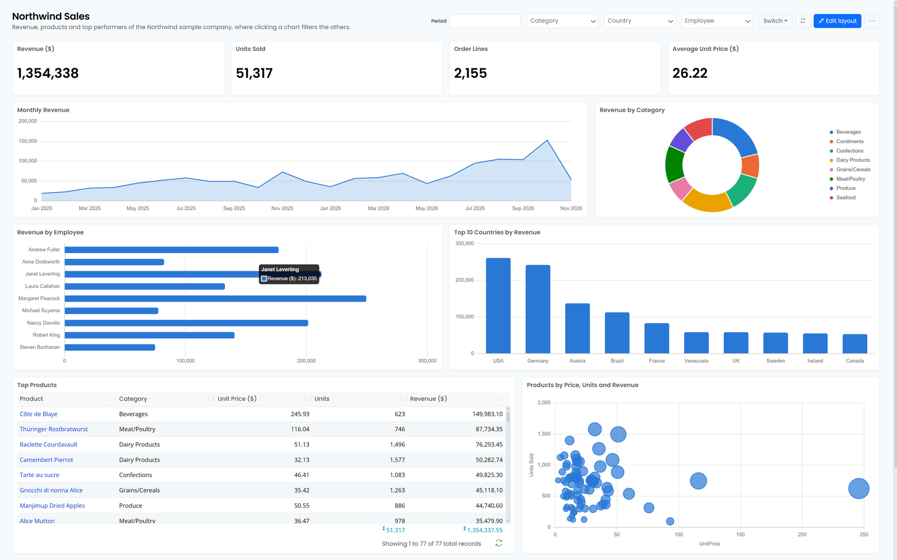
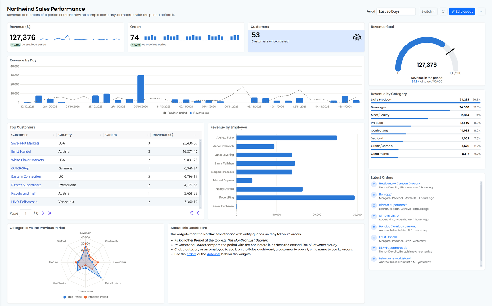
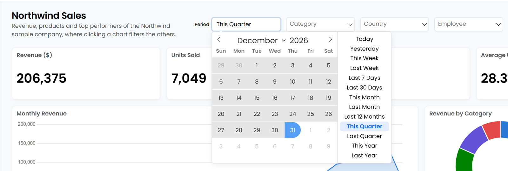
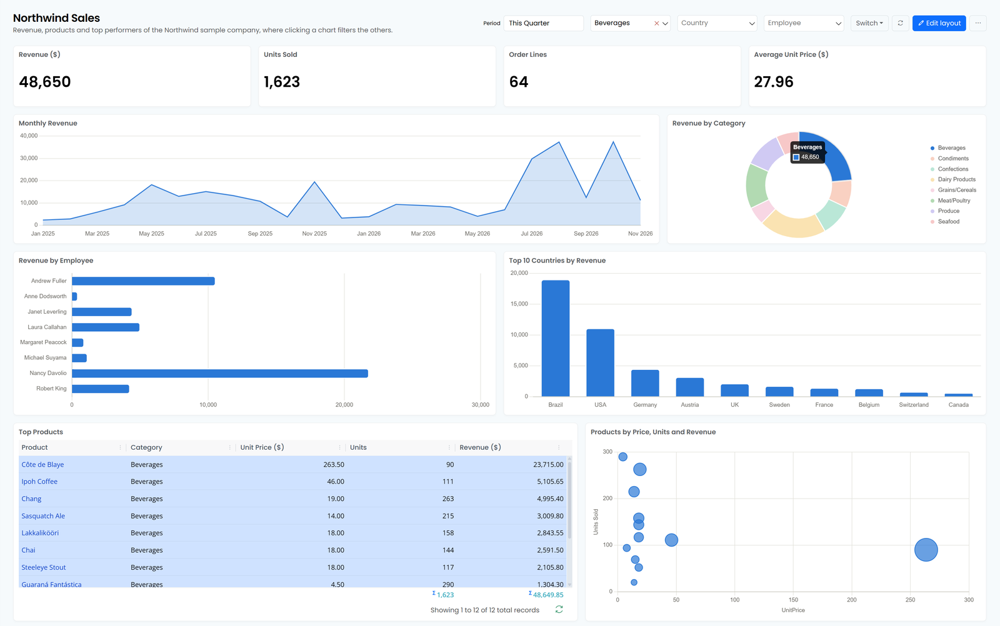
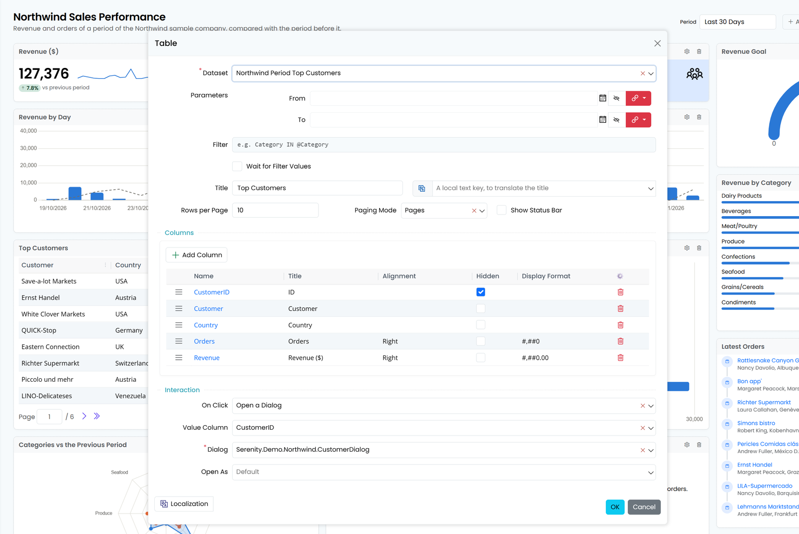
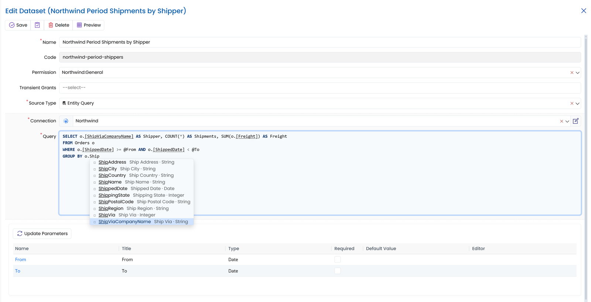
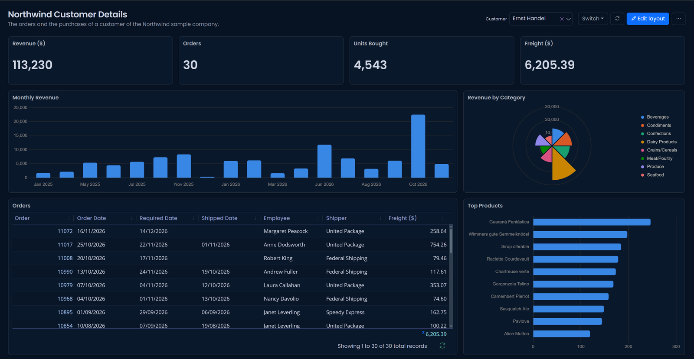

# Dashboards

**Dashboards** lets authorized users design interactive dashboards in the browser, on top of your own application data. They pick widgets, place and resize them on a grid, connect each one to a dataset, add filters, and save — without writing code or redeploying the application.

**DataSources** is the layer underneath: it defines *connections* and *datasets* (named, reusable queries over your data) and runs them with the permissions of the person viewing the dashboard.

The two are separate on purpose. A dataset is written once, secured once and reused by any number of widgets and dashboards, and it is the foundation for other data features.



Dashboards is included in **StartSharp Enterprise**. It is an alternative to a hand-coded dashboard page (a developer is needed for every change) and to a separate BI product (another login, another permission model, data copied out of your database, and dashboards that cannot open your own screens).

Because it is part of the application, it shares everything the application already has:

- **Same users, same sign-in, same permissions.** A dashboard is visible to the users holding its permission, and a dataset returns data only to users allowed to read it.
- **Your data stays where it is.** Queries run live against your own databases, on your own servers.
- **Click through to real screens.** A click on a product in a chart opens the familiar *Product* dialog; a row in an orders table opens the *Order* dialog, where the user can act on it right away.
- **Reuse your business logic.** Datasets can read your **entities** and **list services**, so the rules you wrote in your rows and handlers keep applying.
- **Fits in naturally.** Dashboards appear in the application menu, follow your theme (including dark mode), support localization, and any dashboard can become the **home page** for everyone, for certain roles or for certain users. Users can also pick their own default.

## Widgets



- **Charts**: line, area, bar (stacked or horizontal), pie, doughnut, polar area, radar, scatter and bubble, with multiple series, target lines and a *compare with previous period* option.
- **Number cards**: KPIs with icons, colors, captions, "more" links and a **trend** against the previous period, shown as a line or bars. For values such as costs, a "lower is better" option makes a drop count as good news.
- **Gauges**: progress toward a target.
- **Tables**: full-featured grids with sorting, grouping, summaries, column formatters, pinned columns and links on any column.
- **Lists** and **funnels**: ranked and staged data at a glance.
- **Activity feeds**: the latest events, with icons, dates and links.
- **Text** (Markdown) and **Links** widgets: explanations, instructions and shortcuts.

Charts and numbers can **aggregate in the database** (sum, count, average, minimum, maximum), group dates by hour, day, week, month, quarter or year, and keep only the top groups. Totals are always computed from all the data, not just the rows that were loaded.

## Filters



Each dashboard defines its own filters, shown in its toolbar:

- **Date ranges** with presets such as *Last 30 Days* or *This Quarter*, which always follow today's date.
- **Lookups** over any dataset, for example categories, countries, employees or customers.
- Any other editor your application provides.

Each widget decides how a filter applies to it with a simple expression such as `OrderDate >= @Period.Start AND Category IN @Category`. A clause whose filter is empty is simply skipped, so the same widget works with or without a selection. A detail widget can also wait until the user picks a value — a customer, for example — and ask for it instead of loading everything.

Filter values are kept in the URL (`?f.Category=Beverages`), so a filtered view can be bookmarked or shared with a colleague.

## Click to Explore

Every chart, list, funnel and table can react to a click:

- **Set a filter**: click a category in *Revenue by Category*, and the whole dashboard narrows down to that category. The selection is highlighted, and clicking it again clears it.
- **Open a link**: go to another dashboard with the clicked value as its filter, for example from a top customer to the *Customer Details* dashboard.
- **Open a dialog**: open the entity dialog of the clicked row directly.



## Designing a Dashboard



- Drag-and-drop layout on a responsive grid, with widgets that can be resized freely.
- Widget options in a dialog with sensible defaults, applied to the dashboard as soon as the dialog is saved.
- Table columns configured right from the grid header: hide, pin, sort, group, add or remove.
- A SQL editor with syntax highlighting and context-aware completion of entities, columns, joins and parameters.
- Save conflict detection, so two designers cannot overwrite each other's changes by accident.
- Duplicate a dashboard as a starting point, or start from scratch.

## Datasets



A dataset can read from:

- **Entities**: your Serenity rows, through their list handlers, with the permissions and behaviors you already defined.
- **Entity queries**: SQL-like queries over entities, with joins that follow foreign keys automatically (`LEFT JOIN o.CustomerID c`).
- **Tables and views** of any configured database connection, with an optional filter.
- **SQL queries**: a familiar SQL syntax, which is parsed, checked and rewritten for the target database. The same query works on SQL Server, PostgreSQL, MySQL, SQLite, Oracle and Firebird.
- **List services**: any of your existing `List` endpoints, executed in-process through the full ASP.NET Core pipeline.
- **JSON**: static data for samples and small lookup lists.

Datasets can declare **parameters** with types, defaults and editors. Each widget can bind a parameter to a fixed value, to a dashboard filter, or show it as an editor on the widget itself. A dataset's preview shows its results right in the designer.

## Security

A dashboard system that runs queries against your production database has to be secure by default:

- **Off until you turn it on.** Table and SQL access is disabled for every connection until an administrator enables it in configuration and decides who may author datasets.
- **No raw SQL ever reaches your database.** Every query is parsed into a syntax tree, validated and written out again by the server. Only `SELECT` statements are possible, and every value is sent as a bound parameter, never concatenated into the SQL text.
- **Access rules per connection.** Administrators decide with `Allow`, `Deny` and `Protect` rules which tables and columns can be used, and which permission each one requires. `Deny` always wins.
- **Sensitive data is protected out of the box.** User tables, password hashes, tokens and similar columns are excluded by default. Wildcards never reach them, so only an explicit, intentional rule can expose them.
- **Row-level filters.** A rule can limit the rows of a table for everyone — for example to the current user's records with `CURRENT_USER_ID` — and the filter applies wherever that table is used, including inside joins.
- **Viewers see only what they may see.** Datasets run with the **viewer's** permissions, not the designer's. Each dataset has its own permission, entity sources keep their row and field permissions, and list services run with full authorization checks. A column the viewer cannot read simply isn't there.
- **Controlled privilege grants.** When a dataset must show summary data its viewers cannot read directly, an authorized designer can attach a *transient grant*. It is limited to that dataset and to permissions the designer already holds.
- **Guard rails.** Per-connection command timeouts and row limits keep a careless query from hurting the database. Filter expressions sent from the browser cannot contain subqueries or functions, so they cannot be used to probe other tables.

## Configuration

Table and SQL access is opt-in per connection key. The keys listed under `DataSources:SqlDataConnector:ConnectionKeys` are the ones the data sources may use, and each one states the permission required to use it and what it may read:

```json
{
  "DataSources": {
    "SqlDataConnector": {
      "ConnectionKeys": {
        "Northwind": {
          "Permission": "Northwind:General",
          "Tables": {
            "Permission": "Administration:General",
            "Rules": [ { "Deny": "dbo.Customers(Phone, Fax)" } ]
          },
          "Entities": { "Permission": "Northwind:General" }
        }
      }
    }
  }
}
```

- `Permission` is required for a key to be listed at all. `?` means any authenticated user and `*` means everyone, including anonymous visitors.
- `Tables` controls the table/view and SQL data sources; `Entities` controls the entity and entity-query data sources. Both are off unless their permission is set.
- `CommandTimeout` and `MaxRows` (per key or globally under `SqlDataConnector`) bound how much a single request may do.

The module uses three permissions:

| Permission | Purpose |
| --- | --- |
| `Dashboards:Management` | Create, edit and delete dashboards |
| `DataSources:Management` | Create, edit and delete connections and datasets |
| `DataSources:TransientGranting` | Save a dataset that grants permissions while it runs |

The `Dashboards` section controls designer defaults, such as which columns a widget offers when it is populated from a dataset (`SkipColumnsRegex`), and whether the site has a built-in dashboard of its own (`HasBuiltInDashboard`).

### Menu Refresh in Existing Projects

Dashboards add their own items to the navigation menu, so the cached menu must be refreshed when a dashboard is saved. Projects created from the template already do this. In an existing project, add `NavigationCaching.ItemsGroupKey` to the group keys of the cached items in `NavigationModelFactory.cs`, or dashboard changes only appear in the menu after the cache expires or the application restarts:

```csharp
Items = cache.GetLocalStoreOnly("LeftNavigationModel:NavigationItems:" +
    (userAccessor.User?.GetIdentifier() ?? "-1"),
    TimeSpan.Zero,
    [UserPermissionRow.Fields.GenerationKey, NavigationCaching.ItemsGroupKey],
    () => NavigationHelper.GetNavigationItems(permissions, typeSource, serviceProvider,
        url => ToAbsolute(url)!))!
```

### Project Template

The StartSharp Enterprise project template includes Dashboards by default. Pass `-db false` to `dotnet new startsharp` (or clear the *Dashboards* checkbox in the Visual Studio project wizard) to leave it out of a new project.

## Sample Dashboards

The StartSharp demo comes with four sample dashboards built on the Northwind database, which together show most of the features:

- **Northwind Sales**: revenue trends, sales by category, employee and country, top products, and filters that the charts themselves can set.
- **Sales Performance**: KPIs with trends against the previous period, a category comparison radar, top customers and employee rankings.
- **Operations**: shipping performance, orders waiting to ship, freight by shipper.
- **Customer Details**: everything about a single customer, reachable with one click from any other dashboard.



The sample dashboards and their datasets are migrations tagged `Dashboards`, so they are created only when sample data is requested.

## Source Code

Dashboards and DataSources live in the enterprise features of the StartSharp repository:

[Dashboards Source and Documentation](https://github.com/serenity-premium/startsharp/tree/master/enterprise-features/src/dashboards)

Please ensure that you are logged in to GitHub and have the necessary repository access to view the contents of this folder.
